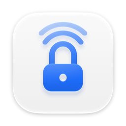
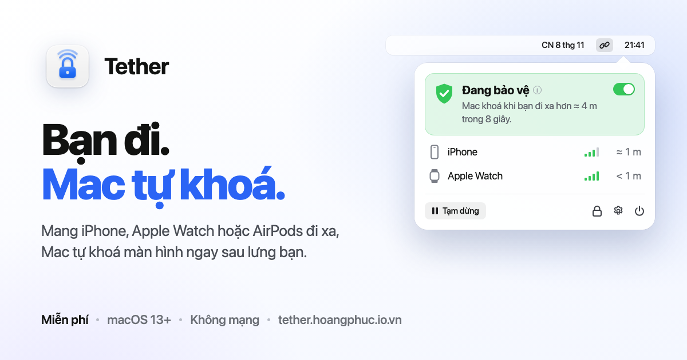
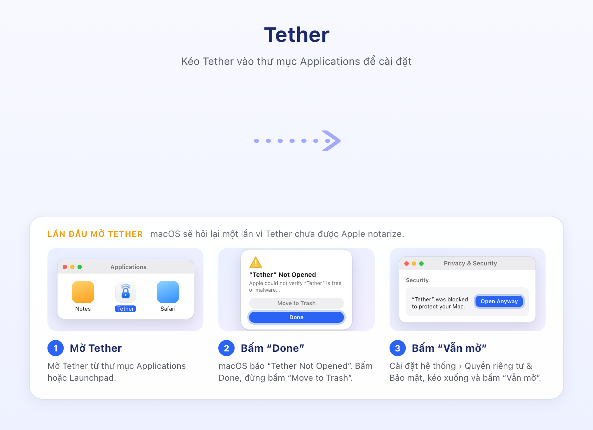

<p align="center">
  
</p>

<h1 align="center">Tether</h1>

<p align="center">
  Sợi dây vô hình giữa bạn và Mac.<br>
  Mang iPhone, Apple Watch hoặc AirPods đi xa, Mac tự khoá màn hình.
</p>

<p align="center">
  
  
  
  
  
  
</p>

<p align="center">
  <a href="https://tether.hoangphuc.io.vn/" target="_blank">Website</a> •
  <a href="https://tether.hoangphuc.io.vn/#install" target="_blank">Tải về</a> •
  <a href="https://tether.hoangphuc.io.vn/whats-new/" target="_blank">Có gì mới</a> •
  <a href="https://hoangphuc.io.vn/" target="_blank">Tác giả</a>
</p>

---

<p align="center">
  
</p>

Tether là app nhỏ trên thanh menu macOS, viết bằng Swift và SwiftUI. Nó lắng nghe sóng Bluetooth mà iPhone, Apple Watch hay AirPods vốn đã tự phát, ước lượng bạn đang ở xa hay gần, và **khoá Mac ngay sau lưng bạn** khi bạn rời bàn. Không cần cài gì lên thiết bị, không kết nối, không gửi dữ liệu đi đâu. Tether chỉ khoá, mở khoá vẫn do macOS lo (mật khẩu, Touch ID hoặc Apple Watch).

## Cài đặt

Tải file `.dmg` mới nhất trên [website](https://tether.hoangphuc.io.vn/#install), mở ra rồi kéo **Tether** vào thư mục **Applications**.

<p align="center">
  
</p>

> [!IMPORTANT]
> Tether chưa được Apple notarize nên **lần mở đầu tiên** macOS sẽ báo *“Tether” Not Opened*:
> 1. Bấm **Done** (đừng bấm *Move to Trash*).
> 2. Mở **Cài đặt hệ thống › Quyền riêng tư & Bảo mật**, kéo xuống và bấm **Vẫn mở** (*Open Anyway*).
>
> Chỉ cần làm một lần. App vẫn chạy trong App Sandbox và không có quyền mạng.

## Tính năng

### Tự khoá khi bạn rời đi

- **Theo dõi thụ động:** iPhone, Watch, AirPods luôn tự phát gói Bluetooth (Handoff, AirDrop…). Tether chỉ nghe và đo độ mạnh sóng (RSSI), không kết nối, không gửi lệnh.
- **Hai thiết bị cùng lúc:** khoá khi *cả hai* đi xa (mặc định) hoặc khi *một trong hai* đi xa.
- **Chống khoá nhầm:** làm mượt sóng, dùng hai ngưỡng tách nhau (mức khoá và mức quay lại), và chỉ khoá khi bạn ở xa liên tục đủ số giây bạn chọn (mặc định 8 giây).
- **Mất tín hiệu cũng tính là đi xa**, và có thể chọn khoá luôn khi Bluetooth bị tắt.

### Thiết lập trong một phút

- **Hướng dẫn lần đầu:** chọn thiết bị, đo sóng ở bàn làm việc và ở chỗ muốn khoá (ví dụ cửa phòng), Tether tự tính ngưỡng cho căn phòng của bạn.
- **Biểu đồ sóng 5 phút:** kéo trực tiếp đường mức khoá và mức quay lại, thấy ngay mỗi lần khoá nằm ở đâu.
- **Nhận lại thiết bị** theo tên khi mã Bluetooth của nó đổi.
- **Đặt lại và xem lại hướng dẫn:** đưa mọi cài đặt về mặc định, hoặc chạy lại phần thiết lập bất cứ lúc nào.

### Gọn trên thanh menu

- Một chạm để **tạm dừng** (15 phút → tới sáng mai), **khoá thử** hoặc mở cài đặt.
- **Lịch sử 50 lần khoá** gần nhất kèm lý do và sóng của từng thiết bị, lưu ngay trên Mac.
- **Mở cùng máy**, tuỳ chọn hiện icon ở Dock, thông báo khi khoá.

### Bảo vệ bạn, không theo dõi bạn

| | |
|---|---|
| **Không mạng** | App Sandbox chỉ có đúng một quyền `com.apple.security.device.bluetooth`. macOS chặn mọi kết nối ra ngoài. |
| **Không thu thập** | Không analytics, không telemetry, không cloud. Tự kiểm chứng: Activity Monitor › Network luôn 0 byte. |
| **Quyền tối thiểu** | Chỉ Bluetooth và Thông báo. Không file, không vị trí, không camera. |
| **Tiết kiệm pin** | Bộ lọc gói trùng của chip Bluetooth, ngừng quét hẳn khi màn hình khoá hoặc Mac ngủ. |

## Cách hoạt động

```
iPhone / Watch / AirPods ──(gói Bluetooth tự phát)──▶ BluetoothService ──RSSI──▶ ProximityEngine ──▶ ScreenLocker
                                                         (lọc, nhận diện)        (EMA, hysteresis,      (khoá ngay,
                                                                                  độ trễ, chính sách)    dự phòng)
```

- **ProximityEngine** (`TetherCore`): làm mượt EMA 0,7/0,3 cho từng thiết bị, hysteresis −75 / −65 dBm, mất tín hiệu quá lâu tính là xa, xa liên tục *N* giây mới khoá.
- **ScreenLocker:** khoá tức thì. Nếu sau 1 giây màn hình chưa khoá thì bật trình bảo vệ màn hình làm phương án dự phòng (cần bật “Yêu cầu mật khẩu ngay”).
- **Quét tiết kiệm:** không lấy gói trùng và khởi động lại phiên quét mỗi 1,5 giây, nên mỗi thiết bị chỉ báo về khoảng một lần mỗi chu kỳ.
- **Khoảng cách** hiển thị chỉ là ước lượng (−59 dBm ≈ 1 m, hệ số suy hao 2,5). Cơ thể, tường và túi quần đều làm sóng yếu đi.

## Build từ mã nguồn

```bash
cd TetherCore && swift test     # chạy unit test phần logic
cd .. && open Tether.xcodeproj  # mở project trong Xcode
scripts/make-dmg.sh             # build Release universal → build/Tether-<version>.dmg
```

Phát hành có ký Developer ID và notarize (để Gatekeeper không hỏi lại):

```bash
DEVELOPER_ID="Developer ID Application: Tên (TEAMID)" NOTARY_PROFILE=tether-notary scripts/make-dmg.sh
```

Xem log khi debug:

```bash
log stream --predicate 'subsystem == "com.simple.tether"' --level debug
```

### Cấu trúc dự án

| Thư mục | Nội dung |
|---|---|
| `TetherCore/` | Swift package logic thuần, có unit test: `ProximityEngine` (nhiều thiết bị, hysteresis, độ trễ), `RSSIHistory`, `Calibration`, `DistanceEstimate`. |
| `Tether/` | App thanh menu (`com.simple.tether`): `BluetoothService`, `ScreenLocker`, `SystemObserver`, `SettingsStore`, `LockHistory` và giao diện SwiftUI. |
| `scripts/icon/` | Bộ tạo icon Liquid Glass dùng chung cho các app (`make-icon.py`), xem [`scripts/icon/README.md`](scripts/icon/README.md). |
| `scripts/dmg-art/` | Nền cửa sổ DMG (800×580) vẽ bằng HTML. Sửa `background.html` rồi chạy `render.sh` (cần Google Chrome) để xuất ảnh. |
| `scripts/make-dmg.sh` | Build Release và đóng gói DMG kéo-thả, có icon ổ đĩa và bố cục cửa sổ. |

## Yêu cầu hệ thống

- **macOS:** 13 Ventura trở lên (Apple Silicon hoặc Intel)
- **Thiết bị:** iPhone, Apple Watch hoặc AirPods đăng nhập cùng Apple ID với Mac, hoặc đã ghép đôi Bluetooth
- **Xcode:** 26 trở lên (để build từ mã nguồn, vì icon dùng định dạng Icon Composer)

## Góp ý

Gặp lỗi hay có ý tưởng? Gửi mail tới [hoangphucdeveloper@gmail.com](mailto:hoangphucdeveloper@gmail.com?subject=Tether%20feedback). Nếu thấy Tether hữu ích, mời mình một ly cà phê qua mã QR trong tab **Giới thiệu** của app nhé ☕

## Bản quyền

© 2026 Nguyễn Hoàng Phúc (S1mple). Mọi quyền được bảo lưu.
